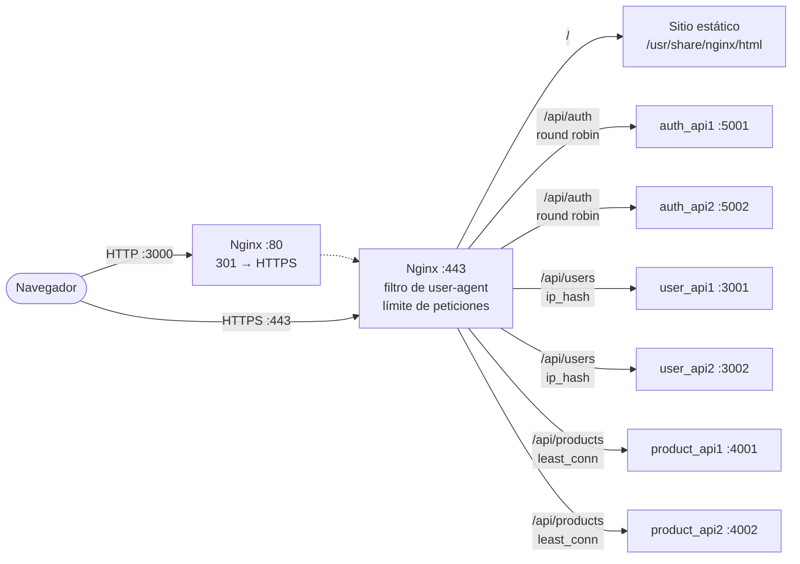

# Prueba de Concepto: Nginx

Este proyecto simple configura un entorno de desarrollo con **Nginx** como servidor proxy inverso que maneja sencillos microservicios basados en **Node.js**. Cada servicio es desplegado utilizando Docker, y Nginx dirige el tráfico a los servicios correspondientes.

## Arquitectura



Todos los contenedores comparten la red `api_network` de Docker Compose. Cada API tiene dos instancias, y cada `upstream` usa una estrategia de balanceo distinta:

| Ruta | Upstream | Estrategia | Comportamiento |
|---|---|---|---|
| `/api/auth` | `auth_api` | Round robin (por defecto) | Alterna entre instancias en cada petición. |
| `/api/users` | `user_api` | `ip_hash` | La misma IP siempre llega a la misma instancia. |
| `/api/products` | `product_api` | `least_conn` | Envía a la instancia con menos conexiones activas. |

Además, Nginx:
- Redirige todo el tráfico HTTP a HTTPS.
- Rechaza con 403 los user-agents de bots, `curl` y `wget`.
- Limita a 5 peticiones por segundo por IP (con ráfagas de hasta 10) y a 1 conexión simultánea.

## Requisitos

- Docker
- Docker Compose

## Instrucciones de Uso

1. Clona este repositorio:
```bash
git clone https://github.com/FelipeUH/PoC-Nginx.git
cd PoC-Nginx
```

2. Construye las imagenes y ejecuta los contenedores utilizando Docker Compose
```bash
docker-compose up --build
```

3. Accede a la aplicación en tu navegador:
* https://localhost: Nginx servirá una página con botones que redirigen a los dos endpoints. Aquí Nginx actúa de servidor web.
* http://localhost/api/users: Nginx redirige la petición GET al microservicio de usuarios y devuelve la respuesta.
* http://localhost/api/products: Nginx redirige la petición GET al microservicio de productos y devuelve la respuesta.
* http://localhost/api/auth: Nginx redirige la petición GET al microservicio de autenticacion y devuelve la respuesta.

Al realizar diferentes peticiones a un mismo endpoint podemos ver que cada vez nos da respuesta una instacia diferente, debido a que Nginx está balanceando las cargas.

4. Para detener los contenedores:
```bash
docker-compose down
```
